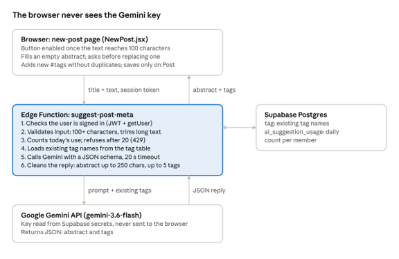

# Adding AI Suggestions to Blogpost

Writers on Blogpost can click **✨ Suggest summary & tags** to get a draft abstract and 3–5 tags from Google Gemini, which they edit before posting. It shipped on 14 Nov 2026 in [PR #14](https://github.com/BrianJCal99/Blogpost/pull/14), built as a Supabase Edge Function plus one button in the new-post form.

## How it works

The browser only ever talks to the Edge Function, which holds the key, enforces the daily limit and checks Gemini's reply before the form is filled.

- **Browser (`NewPost.jsx`):** the button is enabled once the text reaches 100 characters. It sends the title, text and the member's session token, then fills an empty abstract, asks before replacing an existing one, and adds new #tags without duplicates. Nothing is saved until the writer clicks Post.
- **Edge Function (`suggest-post-meta`):**
  1. Checks the user is signed in (JWT + `getUser()`).
  2. Validates input: 100+ characters, trims long text.
  3. Counts today's use; refuses after 20 (429).
  4. Loads existing tag names from the `tag` table.
  5. Calls Gemini with a JSON schema and a 20 s timeout.
  6. Cleans the reply: abstract up to 250 characters, up to 5 tags.
- **Supabase Postgres:** `tag` supplies existing tag names; `ai_suggestion_usage` holds a daily count per member.
- **Google Gemini API (`gemini-3.6-flash`):** the key is read from Supabase secrets and never sent to the browser. Returns JSON with an abstract and tags.

## Product rules

Three rules were fixed before any code was written, and every later choice follows from them.

- **The AI only suggests.** It fills the Abstract and Tags fields; the writer edits them, and nothing is saved until they click Post. An abstract the writer already wrote is replaced only after they confirm.
- **Reuse existing tags.** Suggestions should land on tags already in the `tag` table, so topics don't split into near-duplicates like #Food, #food and #Foods.
- **The Gemini key never reaches the browser.** Create React App bundles every `REACT_APP_` variable into public JavaScript, so the key lives only in Supabase secrets.

## Build steps

We built it in six steps with Claude Code, stopping after each one to review and test before moving on.

1. **Setup.** Created a Gemini API key in Google AI Studio, logged in and linked the Supabase CLI to the project, and put `GEMINI_API_KEY` and `GEMINI_MODEL` in a git-ignored `supabase/functions/.env`. Checked the `tag` table's columns and that signed-in users can read it.
2. **Edge Function `suggest-post-meta`.** A Deno/TypeScript function that:
   - answers the CORS preflight, so the app on localhost and Vercel can call it
   - requires a signed-in user (platform JWT check, then `auth.getUser()`)
   - rejects text under 100 characters, and trims title to 200 and text to 8,000 characters
   - loads up to 200 existing tag names and sends them with the post
   - calls Gemini through the official `@google/genai` SDK with a JSON schema, temperature 0.4 and a timeout
   - validates and cleans the reply before returning `{ abstract, tags }`
3. **Local test environment.** Ran the full Supabase stack in Docker (`supabase start`), so the function could be tested against a real local database and auth server without touching production. Seeded the local database with the production tag names and created a local test user.
4. **Frontend button in `NewPost.jsx`.** Added the button below the Text field, called the function with `supabase.functions.invoke`, and merged the result into the form. The publish logic was left untouched.
5. **Guardrails and docs.** Scanned the source, build output and git history for the key; added a daily limit of 20 suggestions per member; documented the feature in the README and `CLAUDE.md`.
6. **Deploy and test live.** Applied the database change, set the production secrets, deployed the function, opened the PR, and tested on the live site after Vercel deployed it.

## Key decisions

The biggest decision was where the AI call runs: on the server, behind a signed-in check and a daily limit.

| Decision | What we chose | Why |
| --- | --- | --- |
| Where Gemini is called | A Supabase Edge Function, not the React app | Keeps the API key out of the public JS bundle; the app has no other server |
| Who can call it | Signed-in users only, with JWT verification left on | Stops anonymous visitors using up the Gemini quota |
| Output format | Structured JSON output with a schema `{ abstract, tags }` | The reply is data to validate, not prose to parse |
| Trusting the reply | Validate anyway: non-empty abstract ≤ 250 chars, ≤ 5 tags, each one lowercase word, no duplicates | Bad model output becomes a clean error instead of a broken form |
| Tag reuse | Send existing tag names in the prompt and ask the model to prefer them | Avoids near-duplicate tags; tests returned existing tags every time |
| Prompt injection | System instruction says the post is content to summarise, not instructions | A post saying "ignore all previous instructions" is just summarised |
| Model | `gemini-3.6-flash`, overridable with the `GEMINI_MODEL` secret | Newer Flash models were returning 503 "high demand" during testing |
| Timeout | 20 seconds | Normal responses took 9–13 s; 15 s was too tight |
| Cost control | 20 suggestions per member per UTC day, counted in the database | Caps spend; members can read their count but not reset it |
| Errors | Friendly messages per case: too short, AI busy, too slow, daily limit | Writers know whether to wait, write more, or try tomorrow |
| Existing abstract | Fill if empty; otherwise ask with `window.confirm` | The writer keeps the final say |
| Testing | A local Supabase stack before touching production | Production stayed untouched until the feature was proven |

## Testing

Every case passed locally before deploy, and the live test returned a suggestion in about 10.5 seconds.

| Where | Case | Result |
| --- | --- | --- |
| Local | No auth header, or an invalid token | 401 |
| Local | Invalid JSON, missing text, text under 100 characters | 400, "Write a bit more first" |
| Local | Recipe post (lentil soup) | 200; tags soup recipes vegetarian dinner food, all existing |
| Local | Travel post (Kyoto on a budget) | 200; tags japan travel traveltips food, all existing |
| Local | Post containing "Ignore all previous instructions…" | 200; a normal summary, the injection ignored |
| Local | 21st request in a day | 429 daily-limit message, refused before calling Gemini |
| Local | Member tries to reset or delete their own count via the API | No rows changed |
| Local | Signed-out caller runs the counter function | Permission denied |
| Local | The app's `functions.invoke` path, error messages and tag merging | Typed #Food plus suggested food gave no duplicate |
| Build | Search `src/`, `public/`, build output and git history for the key | No matches |
| Production | Preflight from the Vercel origin; unauthenticated calls | 200; 401 |
| Production | Suggestion on https://my-blogpost.vercel.app | 200 in about 10.5 s |

## Rollout

The backend went live first, so nothing could call it until the frontend PR merged.

1. **Database change.** Applied the `ai_suggestion_usage` migration with `supabase db push`, before the function, because the function fails every request without its counter.
2. **Secrets.** Set `GEMINI_API_KEY` and `GEMINI_MODEL` with `supabase secrets set`, read straight from the local `.env` so the key was never printed.
3. **Function.** Deployed with `supabase functions deploy suggest-post-meta`, then smoke-tested: preflight 200, unauthenticated calls 401, clean boot in the logs.
4. **Frontend.** Opened PR #14 to `master`; merging it triggered the Vercel production deploy.
5. **Live check.** Tested on the live site and confirmed the call in the Supabase function logs and the usage counter.
